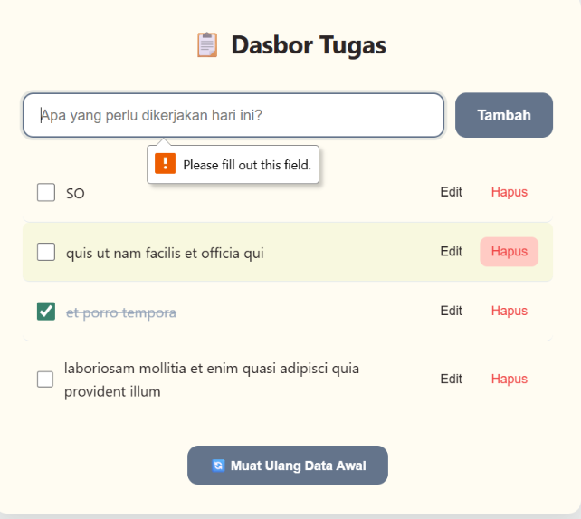
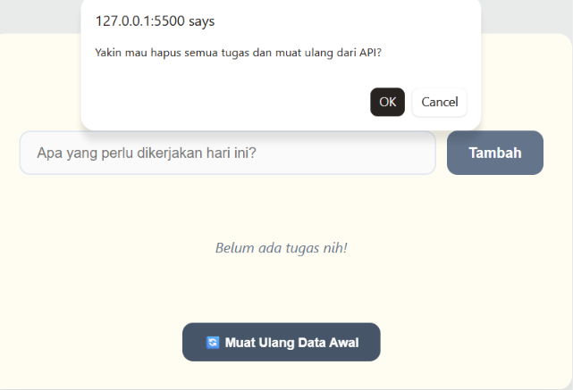
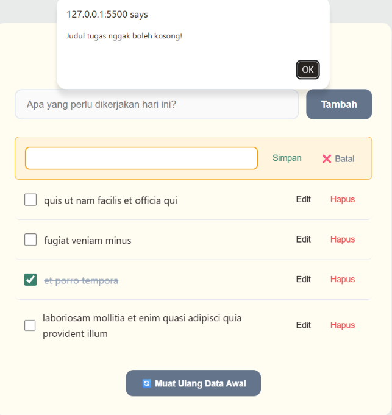

# 📋 Daftar Tugas (Personal Dashboard)

## 📖 Tentang Aplikasi

**Dasbor Tugas** adalah aplikasi web sederhana untuk mengelola daftar pekerjaan harian. Aplikasi ini dibangun menggunakan **Vanilla JavaScript** dengan pola **Object-Oriented Programming (OOP)** dan **ES Modules**.

Data tugas disimpan di browser menggunakan `localStorage` hingga data browser dihapus. Jika belum ada tugas tersimpan, aplikasi akan memuat data awal dari API eksternal ([JSONPlaceholder](https://jsonplaceholder.typicode.com/)).

### ✨ Fitur Utama
- ➕ **Tambah Tugas:** Input tugas baru dengan validasi.
- ✏️ **Edit Inline:** Ubah judul tugas langsung di tempat (tanpa `prompt`).
- 🗑️ **Hapus Tugas:** Kelola daftar tugas dengan mudah.
- ✔️ **Toggle Status:** Tandai tugas selesai/belum selesai.
- 💾 **Penyimpanan Lokal:** Data tersimpan otomatis di `localStorage`.
- 🔄 **Reset Data:** Kembalikan data ke kondisi awal dari API.

---

## 📸 Screenshot Antarmuka

| Tampilan utama | Muat ulang data | Edit tugas |
| :---: | :---: | :---: |
|  |  |  |

---

## Implementasi Fitur ES6+

Berikut adalah daftar fitur ES6+ yang diimplementasikan dalam proyek ini beserta lokasi baris kodenya:

| Fitur ES6+ | File | Baris | Keterangan |
| :--- | :--- | :---: | :--- |
| **`const`** | `js/dashboard.js` | 30, 33–34, 43, 47, 65, 77, 80, 99, 108, 111, 135, 138–140, 157, 161, 174, 212 | Deklarasi variabel yang nilainya tidak ditugaskan ulang. |
| **Arrow Functions** | `js/dashboard.js` | 22, 27, 29, 49, 65, 81, 121, 129, 135, 161, 164, 170, 181, 195 | Digunakan pada event listener dan method array. |
| | `js/main.js` | 3 | Inisialisasi aplikasi saat DOM siap. |
| **Template Literals** | `js/dashboard.js` | 70–74, 91–94, 138, 144–148, 150–155, 157, 191, 195–208 | Rendering HTML dinamis dan query selector. |
| **Async / Await** | `js/dashboard.js` | 69, 77, 80, 98, 104 | Menangani fetch data dari API secara asinkron. |
| **Classes (OOP)** | `js/daftarTugas.js` | 1 | Class `TaskItem` sebagai model data. |
| | `js/dashboard.js` | 3 | Class `dashboard` sebagai controller utama. |
| **Destructuring** | `js/daftarTugas.js` | 2 | `constructor({ id, judul, selesai = false })` |
| **Spread Operator** | `js/daftarTugas.js` | 9 | `{ ...this, ...dataBaru }` untuk membuat data tugas baru saat memperbarui. |
| | `js/dashboard.js` | 112 | `[tugasBaru, ...this.daftarTugas]` untuk menambahkan tugas di awal daftar. |
| **ES Modules** | `js/daftarTugas.js` | 1 | `export default class TaskItem` |
| | `js/dashboard.js` | 1, 3 | `import TaskItem` dan `export default class dashboard` |
| | `js/main.js` | 1 | `import dashboard from './dashboard.js'` |

---

## Cara Menjalankan
> ⚠️ **PENTING:** Proyek ini menggunakan **ES Modules** (`import`/`export`). Kamu **WAJIB** menjalankannya menggunakan **Local Server**. Membuka file `index.html` langsung dari folder (protokol `file://`) akan diblokir oleh browser karena kebijakan CORS.

**Opsi 1: Live Server (VS Code)**
1. Buka folder proyek di VS Code.
2. Install extension **Live Server**.
3. Klik kanan pada `index.html` → **Open with Live Server**.
